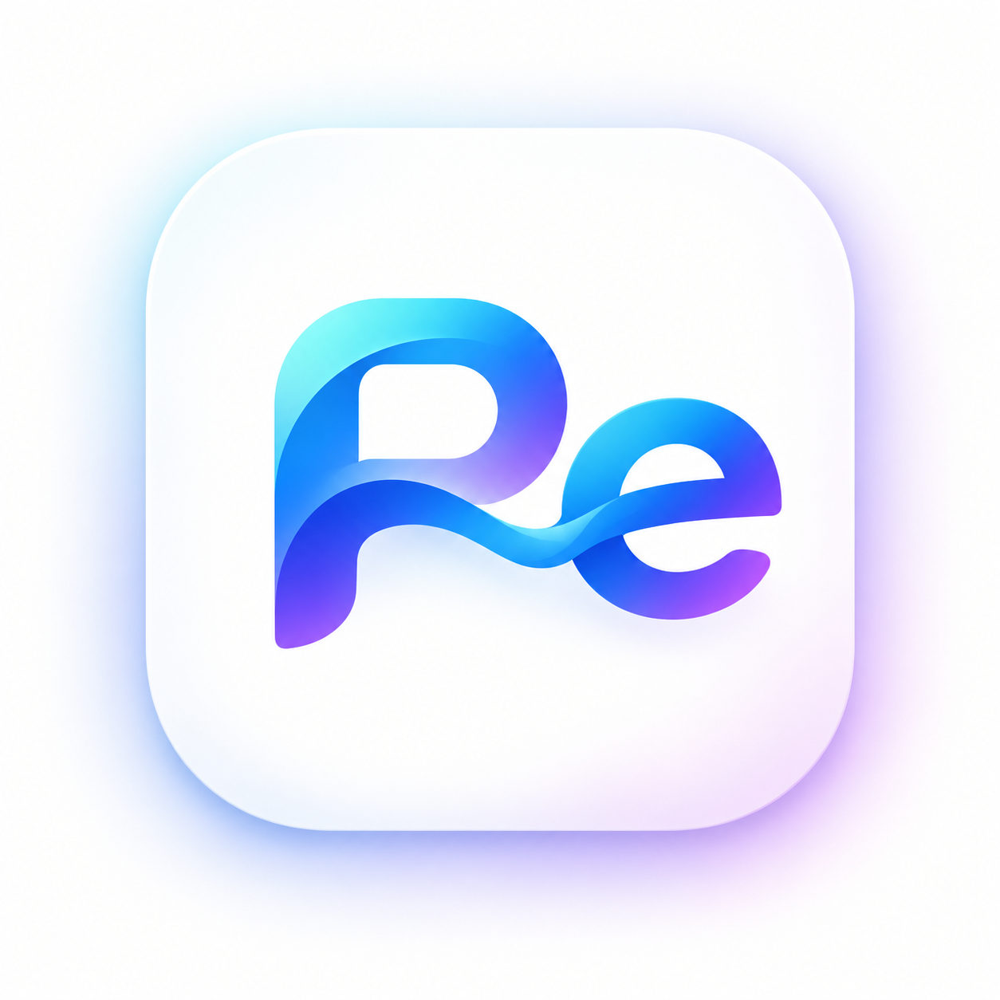
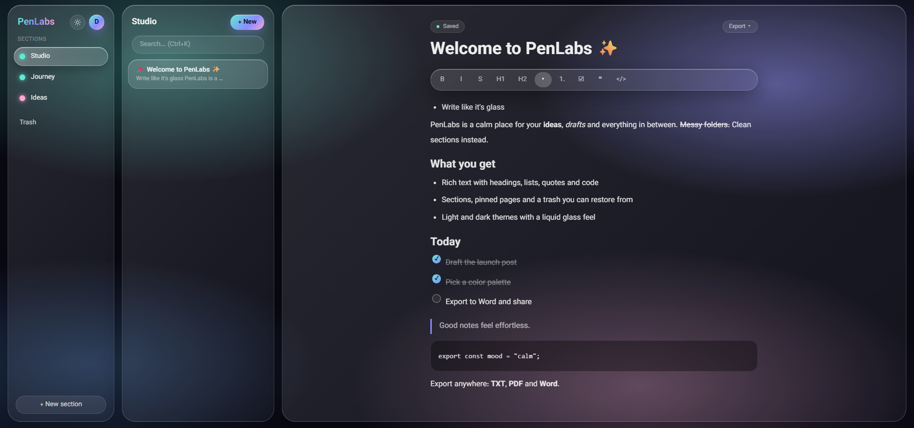
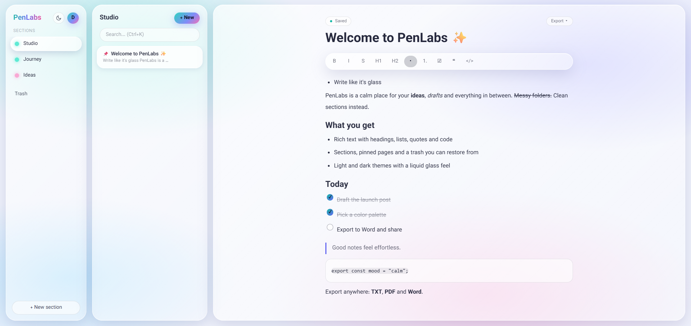
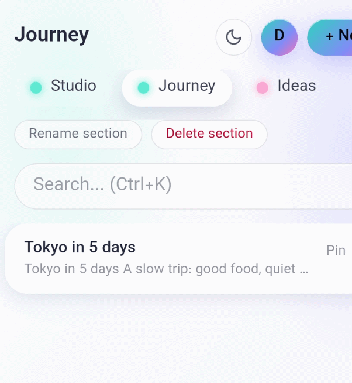

<div align="center">






# PenLabs

**A calm, glassy notes app. Write beautifully, organize in sections, take your notes anywhere.**


</div>

---

## ✨ Highlights

- 🫧 **Liquid glass design.** Translucent, rounded surfaces over a softly animated aurora background, in both light and dark themes.
- 🗂️ **OneNote-style structure.** Sections hold pages, and pages hold your writing, in a three-column layout on desktop.
- 🪄 **Glass tab lens.** Switch sections with a springy glass highlight. On touch screens, press and hold, slide, and release to switch, like on iOS.
- ✍️ **Rich text editor.** Headings, bold, italic, strikethrough, lists, checklists, quotes and code blocks, powered by Tiptap.
- 🌍 **RTL-ready.** Persian and English can live in the same note. Every paragraph picks its own direction automatically.
- 📤 **Export anywhere.** Download as TXT, PDF or Word (`.docx`), or copy formatted text for Samsung Notes and Apple Notes.
- 🗑️ **Trash with restore.** Deleted pages and whole sections go to the trash first, and you can restore or delete them permanently from there.
- 📌 **Pin, search, shortcuts.** Pin important pages, search instantly, and move fast with the keyboard.
- 📱 **Responsive.** A single-column flow on phones, two columns on tablets and three on desktop.
- 🙋 **Guest mode.** Start writing without an account. Guests can keep up to 5 pages in their browser, and those pages move into the account when they sign in.
- 🔐 **Accounts.** Email and password sign-in, with every note and section private to its owner and sign-in attempts rate limited.

## 🧰 Tech stack

| Layer     | Technology                                                                                                                       |
| --------- | -------------------------------------------------------------------------------------------------------------------------------- |
| Framework | [Next.js](https://nextjs.org) (App Router, Route Handlers)                                                                       |
| UI        | React, TypeScript, [Tailwind CSS](https://tailwindcss.com)                                                                       |
| Editor    | [Tiptap](https://tiptap.dev)                                                                                                     |
| Database  | [libSQL](https://github.com/tursodatabase/libsql): a local SQLite file in development, [Turso](https://turso.tech) in production |
| Auth      | Email and password, `scrypt` hashing, hashed session tokens in `httpOnly` cookies                                                |
| Export    | [`docx`](https://github.com/dolanmiu/docx) for Word, the browser print dialog for PDF                                            |
| Hosting   | [Vercel](https://vercel.com)                                                                                                     |

## 🚀 Getting started

### Prerequisites

- Node.js 20 or newer
- npm

### Run it locally

```bash
git clone https://github.com/shayantaghipour/penlabs.git
cd penlabs
npm install
npm run dev
```

Open [http://localhost:3000](http://localhost:3000), create an account and start writing.

In development PenLabs stores everything in a local `local.db` file, created automatically. No database setup is needed.

### Environment variables

Create a `.env.local` file in the project root. Both variables are **optional locally** and **required in production**.

| Variable             | Description                                        |
| -------------------- | -------------------------------------------------- |
| `TURSO_DATABASE_URL` | Your Turso database URL, starting with `libsql://` |
| `TURSO_AUTH_TOKEN`   | A Turso auth token for that database               |

```env
TURSO_DATABASE_URL=libsql://your-database-name.turso.io
TURSO_AUTH_TOKEN=your-token
```

> Never commit `.env.local` or `local.db*`. Both are already listed in `.gitignore`.

### Testing on your phone

Run the dev server on your network:

```bash
npm run dev -- -H 0.0.0.0
```

Then add your computer's local IP to `allowedDevOrigins` in `next.config.ts` and open `http://<your-ip>:3000` on your phone. Both devices must be on the same Wi-Fi.

## ☁️ Deploy

1. Create a database on [Turso](https://turso.tech) and generate a token.
2. Push this repository to GitHub.
3. Import it on [Vercel](https://vercel.com/new).
4. Under **Environment Variables**, add `TURSO_DATABASE_URL` and `TURSO_AUTH_TOKEN`. The variable name goes in the _Key_ field and the value goes in the _Value_ field.
5. Deploy. Tables are created automatically on the first request.

For the best latency, keep your Vercel Function Region close to your Turso database region.

## ⌨️ Keyboard shortcuts

| Shortcut           | Action                  |
| ------------------ | ----------------------- |
| `Ctrl` / `⌘` + `K` | Focus search            |
| `Alt` + `N`        | New page                |
| `Esc`              | Close menus and dialogs |

Shortcuts work with non-Latin keyboard layouts too, such as the Persian layout.

## 🗺️ Project structure

```
penlabs/
├─ app/
│  ├─ layout.tsx            Root layout, fonts, metadata and theme bootstrap
│  ├─ page.tsx              The app shell (sections, pages, editor)
│  ├─ globals.css           Glass design system, themes and editor styles
│  └─ api/
│     ├─ auth/              register · login · logout · me
│     ├─ notes/             list, create, update, pin, trash, delete
│     └─ sections/          list, create, rename, trash, delete
├─ components/
│  ├─ GlassTabs.tsx         Sliding glass lens with press-and-hold switching
│  ├─ SectionsBar.tsx       Section list (desktop)
│  ├─ Sidebar.tsx           Page list, search and trash (plus section chips on small screens)
│  ├─ NoteEditor.tsx        Title, save status and export menu
│  ├─ RichEditor.tsx        Tiptap editor and toolbar
│  ├─ ExportMenu.tsx        TXT · PDF · Word · Notes apps
│  ├─ AuthModal.tsx         Sign in and create account
│  ├─ AccountButton.tsx     Account menu
│  └─ ThemeToggle.tsx       Light and dark switch
└─ lib/
   ├─ db.ts                 libSQL client and schema migrations
   ├─ auth.ts               Password hashing and sessions
   ├─ rate-limit.ts         Database-backed rate limiting for sign-in and sign-up
   ├─ guest.ts              Guest mode storage (browser only) and the 5-page limit
   ├─ export.ts             Export logic
   ├─ text.ts               Plain-text and HTML helpers
   └─ types.ts              Shared types
```

## 🔒 Security notes

- Passwords are hashed with `scrypt` and a random salt. Plain-text passwords are never stored.
- Session tokens are random, and only their SHA-256 hash is stored in the database. Cookies are `httpOnly` and `sameSite=lax`, and `secure` in production.
- Every notes and sections query is scoped to the signed-in user, so one account can't read or change another's data.
- Sign-in is limited to 5 failed attempts per email and 30 per IP address every 15 minutes, and sign-up to 10 attempts per IP address per hour. Counters live in the database, so they work on serverless hosting.
- Known gaps: there is no email verification and no password reset yet. See the roadmap.

## 🛣️ Roadmap

- [x] Sign-in rate limiting
- [x] Guest mode, with notes moved into the account after sign-up
- [ ] Stars (favorites) for signed-in users
- [ ] Password reset and email verification
- [ ] Custom domain
- [ ] Sign in with Google and GitHub

## 🤝 Contributing

Issues and pull requests are welcome. For larger changes, please open an issue first so we can talk it through.

---

<div align="center">

Made with care by [Shayan Taghipour](https://github.com/shayantaghipour)

</div>
